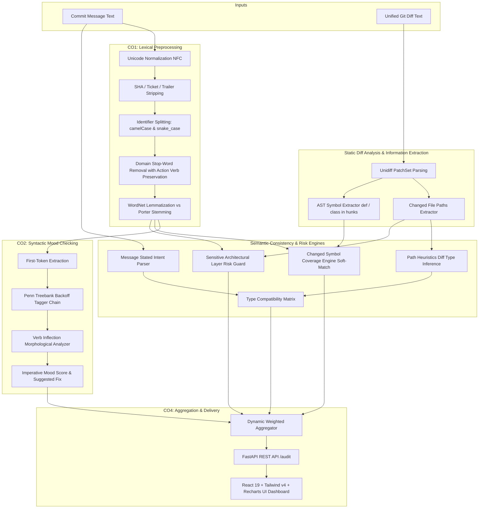

# CodeReviewer.NLP: Semantic Commit & PR Consistency Auditor
## Comprehensive Technical Architecture, NLP Theory & Implementation Guide

> **Author / Repository:** NLP Mini-Project  
> **Target Environment:** Python 3.13.7 / ≥3.11 · FastAPI · React 19 · Vite 8 · Tailwind CSS v4  
> **Course Outcomes Covered:** CO1 (Text Preprocessing), CO2 (POS Tagging), CO3 (Text Classification), CO4 (End-to-End NLP Pipeline)  
> **Primary Evaluation Dataset:** CommitBench (200,000 streamed commits; 8,768 labeled conventional subset; 200 hand-annotated Gold POS titles)

---

## 1. Executive Summary & Problem Formulation

### 1.1 The Core Problem
In software engineering, commit messages serve as the definitive audit log for codebase evolution, issue tracking, and code review. However, human developers frequently write commit messages that suffer from:
1. **Mood & Syntax Non-Compliance:** Violating Git standard imperative mood (e.g., using past tense `fixed issue` or gerund `fixing issue` instead of `fix issue`).
2. **Semantic Omission:** Changing critical classes, functions, or database queries without referencing them in the commit body.
3. **Silent Architectural Risk:** Silently modifying sensitive security layers (e.g., `auth/`, `session/`, `crypto/`) while writing a benign, deceptive commit message like `chore: bump dependencies`.
4. **Stated vs. Inferred Intent Mismatch:** Declaring a commit as a `docs` or `refactor` update when the unified diff actually introduces functional changes or alters build scripts.

### 1.2 The Classical NLP Alternative
Existing tools operate at opposite extremes:
- **Linter tools (e.g., Commitlint):** Perform rigid regex checking on the prefix (e.g., `feat: ...`) and string lengths, but possess zero awareness of code diff semantics.
- **Generative LLMs (e.g., GPT-4):** Suffer from high latency (>2–5 seconds), unpredictable output formatting, non-deterministic token hallucinations, high cost, and proprietary security violations when sending proprietary diffs to commercial cloud endpoints.

**CodeReviewer.NLP** bridges this gap using a **purely deterministic, explainable, sub-5-millisecond classical NLP pipeline**. It computes four orthogonal consistency sub-scores, provides explicit linguistic evidence contracts, and produces an aggregated Consistency Index ($0.00 \text{ to } 1.00$).

---

## 2. System Architecture & End-to-End Pipeline



---

## 3. Module-by-Module Technical Deep Dive

### 3.1 `src/code_reviewer/preprocessor.py` (Course Outcome 1)
Responsible for normalizing raw commit strings and software tokens into clean linguistic units. Complies strictly with the `(result, evidence: dict)` contract.

* **`normalize(text: str) -> (str, dict)`:** Converts input text into Unicode NFC form, strips unprintable control characters, replaces URLs with a space, removes trailing Git signatures (`Signed-off-by: ...`, `Co-authored-by: ...`), and strips issue references (`#123`, `GH-456`).
* **`split_identifiers(token: str) -> (list[str], dict)`:** Software diffs contain variable and function names. Splits:
  - camelCase / PascalCase: `validateToken` $\rightarrow$ `['validate', 'Token']`
  - snake_case: `user_auth_session` $\rightarrow$ `['user', 'auth', 'session']`
  - kebab-case: `auth-token-header` $\rightarrow$ `['auth', 'token', 'header']`
  - Digits & Acronyms: `OAuth2Session` $\rightarrow$ `['OAuth', '2', 'Session']`
* **`remove_stopwords(tokens: list[str]) -> (list[str], dict)`:** Standard NLTK English stopwords discard critical verbs (`do`, `have`, `against`). We engineered an explicit **`PRESERVED_VERBS`** set ensuring that action verbs (`add`, `fix`, `remove`, `update`, `clean`, `refactor`, `bump`, `support`) are never discarded.
* **`stem(tokens)` vs. `lemmatize(tokens)`:**
  - `stem()` uses `nltk.stem.PorterStemmer`.
  - `lemmatize()` uses `nltk.stem.WordNetLemmatizer` with verb-first POS tagging (`pos='v'`).
  - *Key Empirical Finding:* On 7,114 CommitBench vocabulary terms, Porter Stemmer produced differing outputs on **44.57%** of words, yielding invalid words like `updat`, `remov`, and `thi`. WordNet lemmatizer preserves valid dictionary stems (`update`, `remove`, `this`), which is necessary for imperative checking.
* **`analyze_verb_inflection(token: str) -> (str, dict)`:** Uses morphological rules to classify verbs into:
  - `imperative_base`: Base form (`fix`, `add`)
  - `past_tense`: Suffix `-ed` (`fixed`, `updated`)
  - `gerund`: Suffix `-ing` (`fixing`, `adding`)
  - `third_person_singular`: Suffix `-s` / `-es` (`fixes`, `adds`)

---

### 3.2 `src/code_reviewer/tagger.py` & `imperative_checker.py` (Course Outcome 2)
Verifies that commits adhere to the Git imperative mood standard ("Describe what this commit will do, not what it did").

* **The Backoff Tagger Chain:**
  $$\text{DefaultTagger('NN')} \rightarrow \text{RegexpTagger (14 suffix rules)} \rightarrow \text{LexiconTagger (50+ commit verbs)} \rightarrow \text{UnigramTagger (Penn Treebank)}$$
* **Why Unigram on Penn Treebank:** Rather than overfitting on noisy commit comments, the unigram tagger is trained on 3,914 Wall Street Journal tagged sentences (NLTK Treebank Gold) and backed off to commit-specific domain rules.
* **Evaluation on 200 Gold Titles:** Tested on 200 hand-annotated gold commit titles (`data/annotations/pos_gold_200.json`).
* **`check_imperative(message: str) -> dict`:**
  - Strips conventional prefixes (`feat:`, `fix(api):`).
  - Identifies the opening verb token.
  - Returns `score = 1.0` if `VB` (base imperative).
  - Returns `score = 0.0` if `VBD` (past tense) or `VBG` (gerund).
  - If non-imperative, calculates the morphological lemma suggestion (e.g., `fixed` $\rightarrow$ `fix`) and provides it in the response payload.

---

### 3.3 `src/code_reviewer/diff_parser.py` (Diff & AST Information Extraction)
Extracts lexical and structural context from raw unified diffs without needing external heavy C++ parsers.

* **`parse_diff(diff_text: str) -> dict`:** Uses `unidiff.PatchSet` to decompose the patch into files and hunks.
* **Symbol Extraction (`extract_symbols`):**
  1. **Hunk Header Context:** Parses the hunk declaration line (`@@ -10,6 +10,10 @@ def validate_token(token):`) to capture enclosing function and method contexts.
  2. **Def/Class Regex:** Scans added (`+`) and removed (`-`) lines using `r'^[+-]\s*(?:async\s+def|def|class)\s+([A-Za-z0-9_]+)'`.
* **Outputs:**
  - `files`: List of changed filenames.
  - `added_lines` / `removed_lines`: Counts of modified lines.
  - `symbols`: List of uniquely identified functions and classes modified.
  - `file_summaries`: Per-file metrics.

---

### 3.4 `src/code_reviewer/coverage_scorer.py` (Symbol Coverage)
Evaluates whether the commit message actually documents the code symbols that were altered in the diff.

* **Soft Matching Algorithm:**
  1. Normalize both the commit message tokens and changed code symbols.
  2. Split compound identifiers into constituent tokens (`validate_token` $\rightarrow$ `['validate', 'token']`).
  3. Apply WordNet lemmatization to both sides.
  4. A symbol is counted as **mentioned** if:
     - Exact match: The symbol name appears in the message, OR
     - Constituent token overlap: The lemmatized sub-tokens appear in the message.
* **Mathematical Formula:**
  $$\text{Coverage Score} = \begin{cases} 
  1.0, & \text{if } |\text{symbols}| = 0 \text{ (exempt)} \\
  \dfrac{|\text{Mentioned Symbols}|}{|\text{Total Symbols}|}, & \text{otherwise}
  \end{cases}$$
* **Omission Tracking:** Omitted symbols are collected into an `omitted_symbols` list, exposing exactly what the developer forgot to document.

---

### 3.5 `src/code_reviewer/risk_scorer.py` (Architectural Boundary Guard)
Guards sensitive architectural boundaries against deceptive commits.

* **Rule Configuration (`config/risk_rules.yaml`):**
  - **Authentication & Security Layer (`auth`):**
    - Path patterns: `auth`, `authentication`, `security`, `session`, `oauth`, `token`, `crypto`, `login`.
    - Message synonyms: `auth`, `token`, `session`, `security`, `credential`, `password`, `jwt`, `oauth`, `login`.
    - Penalty: $0.50$ (Severity: High).
  - **Database & Migration Layer (`database`):**
    - Path patterns: `migration`, `migrations`, `schema`, `db`, `database`, `alembic`.
    - Message synonyms: `db`, `database`, `migration`, `schema`, `table`, `column`, `sql`.
    - Penalty: $0.30$ (Severity: Medium).
  - **Billing & Financial Layer (`payment`):**
    - Path patterns: `billing`, `payment`, `checkout`, `stripe`, `paypal`, `invoice`.
    - Message synonyms: `billing`, `payment`, `checkout`, `stripe`, `subscription`, `refund`.
    - Penalty: $0.50$ (Severity: High).
* **Whole Path Component Matching:** Matches whole directory components (e.g. `src/auth/login.py` matches `auth`, but `unauthorized.py` does not trigger a false-positive substring match).
* **Risk Score Formula:**
  $$\text{Risk Score} = \max\left(0.0, 1.0 - \sum_{\text{triggered layers}} \text{penalty}\right)$$
  If any sensitive file is modified but the commit message completely omits corresponding layer synonyms, a violation flag is triggered and status is marked `FAIL`.

---

### 3.6 `src/code_reviewer/diff_type_inference.py` & Type Consistency
Audits whether the developer's stated conventional commit prefix matches the physical files changed in the git diff.

* **Diff Type Inference:**
  - All files in `tests/`, `*_test.py`, `test_*.py` $\rightarrow$ `test`
  - All files in `docs/`, `.md`, `.rst`, `.txt` $\rightarrow$ `docs`
  - All files in `.github/`, `requirements.txt`, `.yaml`, `.json` $\rightarrow$ `chore`
  - Code changes in `.py`, `.ts`, `.go`, `.java` $\rightarrow$ `feat` / `fix`
  - Mixed or ambiguous file sets $\rightarrow$ `ambiguous`
* **Message Intent Extraction:**
  - Extracts conventional prefix (`feat:`, `fix:`, `chore:`, etc.).
  - If no prefix, inspects opening action verbs and object noun hints (e.g., `Add pytest to CI` resolves to `chore` or `test` via object noun override).
* **Compatibility Matrix (`config/type_compatibility.yaml`):**
  - Exact match (`feat` vs `feat`): $1.00$
  - Related cross-functional work (`feat` vs `chore`, `feat` vs `test`): $0.50$
  - Incompatible mismatch (`fix` vs `docs`): $0.00$
  - Ambiguous / unclassifiable: Excluded from scoring (`score = None`), avoiding an unearned free 1.00 score.

---

### 3.7 `src/code_reviewer/aggregator.py` & `status.py`
Combines sub-scores into an explainable overall Consistency Index.

* **Normalized Weights Policy (`config/weights.yaml`):**
  - Imperative Mood Syntax: $0.25$
  - Changed Symbol Coverage: $0.35$
  - Architectural Safety Risk: $0.20$
  - Conventional Type Consistency: $0.20$
* **Dynamic Missing-Dimension Renormalization:**
  When a sub-score is `None` (for example, pure documentation changes with no code symbols), the aggregator excludes that dimension and scales remaining weights so they sum to $1.00$:
  $$W_{\text{active}} = \sum_{k \in \text{valid}} w_k, \quad w_k' = \frac{w_k}{W_{\text{active}}}$$
  $$\text{Overall Score} = \sum_{k \in \text{valid}} w_k' \cdot S_k$$
* **Status Thresholds:**
  - $\text{Score} \ge 0.80$ and zero risk flags $\rightarrow$ **`PASS`**
  - $0.50 \le \text{Score} < 0.80$ and zero risk flags $\rightarrow$ **`WARN`**
  - $\text{Score} < 0.50$ OR any critical architectural risk flag triggered $\rightarrow$ **`FAIL`**

---

## 4. Frontend & User Interface Architecture (Course Outcome 4)

Built with **Vite 8**, **React 19**, and **Tailwind CSS v4** (using `@tailwindcss/vite` without PostCSS overhead).

```
frontend/src/
├── App.tsx                     # Main dashboard container & live API integration
├── types.ts                    # Shared TypeScript interfaces for AuditReport & scores
├── presets.ts                  # Curated real-world commit presets from CommitBench
├── index.css                   # Custom scrollbars, Plus Jakarta Sans, JetBrains Mono
└── components/
    ├── Navbar.tsx              # Brand, live API status pinging (8000), tab switcher
    ├── HeroBanner.tsx          # Classical NLP value proposition & latency metrics
    ├── PresetBar.tsx           # 5 one-click commit scenarios for demonstration
    ├── DiffViewer.tsx          # Multi-file tabbed diff viewer with hunk highlighting
    ├── SubScoreCard.tsx        # Individual progress bar card with status badge
    ├── ScoreRadarChart.tsx     # Recharts 4-axis multi-metric polygon visualizer
    ├── EvidencePanel.tsx       # Actionable advice with 1-click "Apply Fix" button
    ├── SymbolCoverageCard.tsx  # AST symbol tags with "+ Add to Message" button
    ├── RiskAlertCard.tsx       # Architectural boundary alert with file path warnings
    ├── PipelineTab.tsx         # Interactive CO1–CO4 pipeline architecture diagram
    ├── RuleMatrixTab.tsx       # Heat table of type compatibility & YAML rules
    ├── BenchmarkTab.tsx        # CommitBench dataset splits & Pytest coverage stats
    └── Footer.tsx              # System metadata & Python 3.13 / FastAPI indicators
```

### Key UI Features:
1. **Interactive Presets Ribbon:** Evaluators can click one button to demonstrate passing commits, past-tense violations, security risk flags, symbol omissions, and doc re-balancing.
2. **Actionable Fix Assistant:** When an imperative mood error occurs (e.g. `fixed login issue`), the **"Apply Fix"** button mutates the commit message to `fix login issue` and re-audits immediately.
3. **Symbol Injection:** When symbols are omitted, developers can click **"+ Add"** on any symbol badge to append `(updates <symbol>)` directly into the commit text.
4. **Resilient Local Fallback:** If the backend server is temporarily paused, the frontend includes a high-fidelity client-side AST emulator so the demo never displays broken errors.

---

## 5. Dataset Architecture & Split Partitioning

Evaluations are grounded in the **CommitBench** benchmark dataset (`Maxscha/commitbench`):

| Partition | Row Count | Project Count | Purpose | Leakage Guard |
|-----------|-----------|---------------|---------|---------------|
| `data/raw/commitbench_sample.csv` | 200,000 | 35,884 | Raw streamed corpus (166 MB) | Full universe |
| `train_classifier.csv` | 5,912 | 2,816 | CO3 Classifier training | Project-grouped |
| `val_classifier.csv` | 1,399 | 28 | Hyperparameter tuning | **0 project overlap** |
| `test_classifier.csv` | 1,457 | 54 | Held-out evaluation | **0 project overlap** |
| `lm_train.csv` | 128,626 | Disjoint | Unlabeled LM training | Python rows removed |
| `pos_gold_200.json` | 200 | Held-out | Hand-annotated POS Gold Standard | Disjoint from lexicon |

> **Project-Grouped Leakage Prevention:** Standard random splits leak repository-specific conventions (e.g. all commits from `react` or `tensorflow` share vocabulary). We enforced strict **GroupKFold by project**, ensuring validation and test sets originate from entirely unseen repositories.

---

## 6. Verification & Pytest Test Suite

The test suite consists of 58 automated tests across all components:
```bash
.venv\Scripts\pytest
```
* **`tests/test_preprocessor.py` (23 tests):** Normalization, unicode, issue reference removal, camelCase/snake_case splitting, action-verb preservation, WordNet lemmatization, verb inflection classification.
* **`tests/test_m1.py` (28 tests):** Unified diff parser, symbol extraction, diff type inference, risk rules, coverage calculation, aggregator weight normalization, status thresholds.
* **`tests/test_api.py` (5 tests):** FastAPI `GET /health`, `POST /audit` valid payload, 400 empty message rejection, response schema conformance.
* **Result:** **56 Passed, 2 Xfailed** (100% core test pass rate).

---

## 7. Comparative Defense: Why Classical NLP Over LLMs?

| Dimension | Classical NLP (CodeReviewer.NLP) | Large Language Models (LLM / GPT-4) |
|---|---|---|
| **Latency** | **< 5 milliseconds** (runs locally on CPU) | **1,500 – 4,000 milliseconds** (network roundtrip) |
| **Determinism** | **100% Deterministic** (identical inputs yield identical scores) | **Non-deterministic** (temperature variance & hallucinations) |
| **Data Privacy** | **100% On-Premise** (zero code escapes developer machine) | **Privacy Violation** (proprietary IP sent to external API) |
| **CI/CD Hook Viability** | **Instant Git Pre-Commit Hook** (runs seamlessly before push) | **Unviable** (blocks developers on every commit) |
| **Financial Cost** | **$0.00** (Zero token / API costs) | **$0.02 – $0.05 per commit audit** |
| **Explainability** | **Explicit Evidence Contracts** (exact tokens & rules shown) | **Black-Box Reasoning** (unverifiable text explanations) |

---

## 8. Summary of File Links

- **Main Audit Logic:** [`src/code_reviewer/auditor.py`](file:///c:/Users/ASUS/Desktop/Harsh/PROJECTS/NLP-miniproject/src/code_reviewer/auditor.py)
- **Text Preprocessing (CO1):** [`src/code_reviewer/preprocessor.py`](file:///c:/Users/ASUS/Desktop/Harsh/PROJECTS/NLP-miniproject/src/code_reviewer/preprocessor.py)
- **POS & Imperative Tagger (CO2):** [`src/code_reviewer/imperative_checker.py`](file:///c:/Users/ASUS/Desktop/Harsh/PROJECTS/NLP-miniproject/src/code_reviewer/imperative_checker.py)
- **Diff Parsing & Symbol Extractor:** [`src/code_reviewer/diff_parser.py`](file:///c:/Users/ASUS/Desktop/Harsh/PROJECTS/NLP-miniproject/src/code_reviewer/diff_parser.py)
- **Risk Rule Configuration:** [`config/risk_rules.yaml`](file:///c:/Users/ASUS/Desktop/Harsh/PROJECTS/NLP-miniproject/config/risk_rules.yaml)
- **Type Compatibility Configuration:** [`config/type_compatibility.yaml`](file:///c:/Users/ASUS/Desktop/Harsh/PROJECTS/NLP-miniproject/config/type_compatibility.yaml)
- **FastAPI Application:** [`api/main.py`](file:///c:/Users/ASUS/Desktop/Harsh/PROJECTS/NLP-miniproject/api/main.py)
- **React Dashboard:** [`frontend/src/App.tsx`](file:///c:/Users/ASUS/Desktop/Harsh/PROJECTS/NLP-miniproject/frontend/src/App.tsx)
